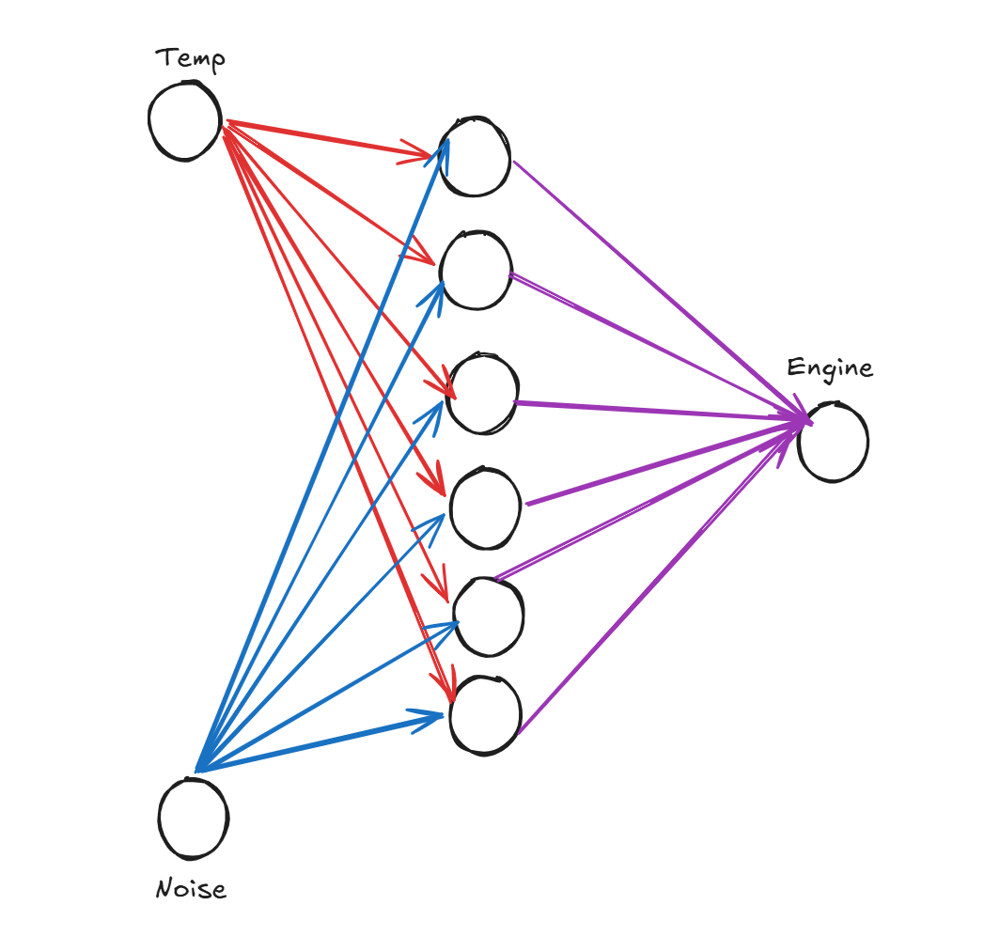
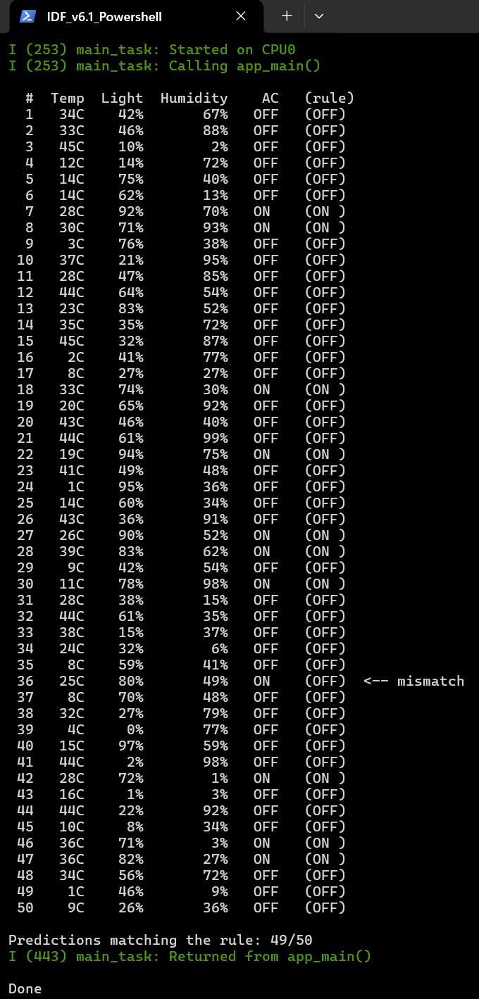

# HW4-1: TinyML on the ESP32

Train a small artificial neural network (ANN) in Python with TensorFlow/Keras, export its weights as C arrays, and run the same forward pass on the ESP32.

| File | Purpose |
| --- | --- |
| `tinyML.py` | Example model: temperature and noise in, engine ON/OFF out. Trains the network and prints its weights as C arrays |
| `tinyML.c` | ESP32 inference for the engine model, with the weights pasted in from `tinyML.py` |
| `tinyML_ac.py` | Air-conditioner model: builds a 100,000-sample database, sweeps hidden-layer size and number of epochs, keeps the best model, and writes `esp32_ac/main/ac_model_weights.h` |
| `tinyML_ac.c` | ESP32 inference for the AC model. Predicts 50 random sensor readings and checks each one against the rule |

## Neural network

The network is fully connected: every input feeds every hidden ReLU node, and every hidden node feeds the single output node.

Editable source: [`tiny_ML_ac_neuralflow.excalidraw`](tiny_ML_ac_neuralflow.excalidraw)

## Air-conditioner model

Sensors:

- Temperature: 0 to 45 °C
- Light: 0 to 100 %
- Humidity: 0 to 100 %

Rule the model learns: the AC is **ON** when `light > 70 % AND (temperature > 25 °C OR humidity > 65 %)`.

The network is 3 inputs -> N hidden ReLU nodes -> 1 sigmoid output. `predict()` in `tinyML_ac.c` checks `result > 0` instead of `sigmoid(result) > 0.5`, because the two are equivalent and this avoids calling `exp()`.

## ESP32 output

`tinyML_ac.c` running on the ESP32. The `(rule)` column is the answer from the rule above, and any prediction that differs from it is marked `<-- mismatch`. The model matched the rule on 49 of 50 samples. The single miss (#36, 25 °C) falls on the `temperature > 25` boundary.

