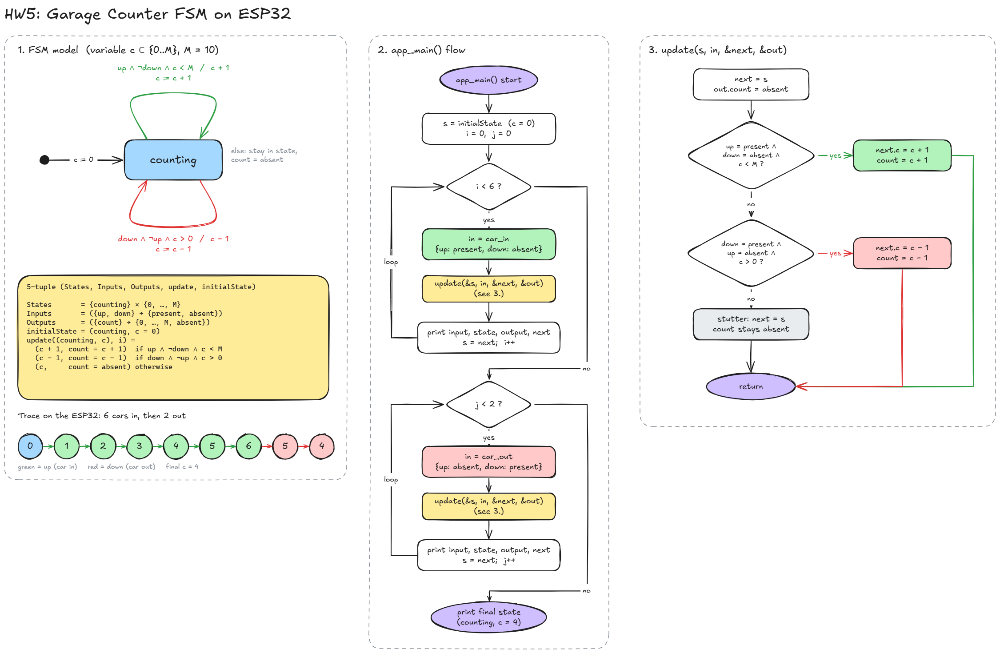
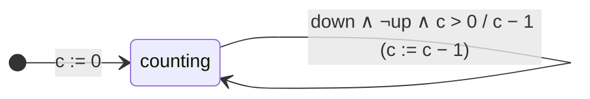

# HW5 – Garage Counter FSM on ESP32

An extended finite-state machine counts the cars in a garage. The pure input `up` means a car arrived and `down` means a car left. The output `count` reports the new number of cars whenever it changes. The FSM's `update` function is written in C and runs on an ESP32 (ESP-IDF v6.1).



The flowchart has three panels:

1. **FSM model** – the single `counting` mode with its two guarded self-loops, the 5-tuple, and the state trace measured on the ESP32.
2. **`app_main()` flow** – starts from an empty garage, sends six `car in` reactions, then two `car out` reactions.
3. **`update()` logic** – the decision chart for one reaction of the FSM.

The editable source is [`hw5_flow.excalidraw`](hw5_flow.excalidraw). Open it at <https://excalidraw.com>.

## FSM



### Formal description: (States, Inputs, Outputs, update, initialState)

Variable `c ∈ {0, …, M}`, with M = 10 in the code.

| Element | Definition |
|---|---|
| **States** | {counting} × {0, …, M} |
| **Inputs** | ({up, down} → {present, absent}) (two pure inputs) |
| **Outputs** | ({count} → {0, …, M, absent}) |
| **initialState** | (counting, c = 0) |
| **update** | States × Inputs → States × Outputs, defined below |

```
update((counting, c), i) =
    ((counting, c + 1), count = c + 1)   if i(up) = present  ∧ i(down) = absent ∧ c < M
    ((counting, c − 1), count = c − 1)   if i(down) = present ∧ i(up) = absent  ∧ c > 0
    ((counting, c),     count = absent)  otherwise (stutter)
```

## Code

[`hw5_main.c`](hw5_main.c)

- `update(s, in, &next, &out)` is a direct translation of the update function above. It starts from `next = s` with `count` absent. If only `up` is present and `c < M`, it increments `c`. If only `down` is present and `c > 0`, it decrements `c`. Otherwise it leaves the state unchanged.
- `app_main()` starts at `initialState` (empty garage). It applies `car_in = {up: present, down: absent}` six times and then `car_out = {up: absent, down: present}` twice. For each reaction it prints the inputs, the current state, the output and the next state.

## Build, flash and monitor

This folder holds the `main` component: `hw5_main.c` and its `CMakeLists.txt`. To build it:

1. Create an ESP-IDF project, for example by copying `examples/get-started/hello_world`.
2. Replace that project's `main/` folder contents with these two files.
3. From an ESP-IDF terminal, in the project folder, run:

```powershell
idf.py set-target esp32
idf.py build
idf.py -p COM3 flash monitor     # replace COM3 with your port; Ctrl+] exits
```

## ESP32 output

```
HW5 garage counter FSM (M = 10)
Initial state: (counting, c=0) - empty garage

1    car in     | up=present down=absent  | state=(counting, c= 0) | count=1      | next=(counting, c= 1)
2    car in     | up=present down=absent  | state=(counting, c= 1) | count=2      | next=(counting, c= 2)
3    car in     | up=present down=absent  | state=(counting, c= 2) | count=3      | next=(counting, c= 3)
4    car in     | up=present down=absent  | state=(counting, c= 3) | count=4      | next=(counting, c= 4)
5    car in     | up=present down=absent  | state=(counting, c= 4) | count=5      | next=(counting, c= 5)
6    car in     | up=present down=absent  | state=(counting, c= 5) | count=6      | next=(counting, c= 6)
7    car out    | up=absent  down=present | state=(counting, c= 6) | count=5      | next=(counting, c= 5)
8    car out    | up=absent  down=present | state=(counting, c= 5) | count=4      | next=(counting, c= 4)

Final state: (counting, c=4) cars in garage
```

The state trace is 0 → 1 → 2 → 3 → 4 → 5 → 6 → 5 → 4. Six cars came in and two left, so four cars are in the garage.
